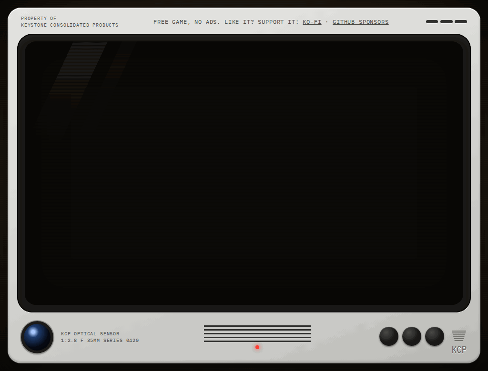

<div align="center">

# INSERT COIN

**A Vim arcade trainer that runs in your browser.**

_Keystone Consolidated Products welcomes you, Operator 0420._
_All keystrokes are monitored for quality purposes._

### [▶ Play in your browser](https://deafcatsteam.github.io/insert-coin-vim/)

[](https://github.com/deafcatsteam/insert-coin-vim/actions/workflows/ci.yml)
[](LICENSE)




</div>

Status: early version (v0.1). You do not need to know Vim to start.

## How it works

1. Each level shows a text and a target. The differences are highlighted.
2. You change the text into the target with real Vim keys.
3. The level ends as soon as the text matches the target. Any solution is accepted.
4. You get one star for finishing, two for reaching par, three for matching the reference
   solution: the shortest one we know with the keys taught so far. A shorter one also gets three.
   Keys are counted like on [VimGolf](https://www.vimgolf.com/): `Esc` and `Enter` count as one key each.

## What you learn

| Chapter          | Levels | Keys                                           |
| ---------------- | ------ | ---------------------------------------------- |
| 0 — Boot         | 5      | `i` `Esc` `h` `j` `k` `l` `:wq`                |
| 1 — Basic edits  | 6      | `x` `dd` `a` `A` `I` `o` `O` `u` `Ctrl+R`      |
| 2 — Word motions | 4      | `w` `b` `e` `W` `B` `E` `0` `^` `$` and counts |
| 3 — Grammar      | 5      | `dw` `D` `cw` `yy` `p` `P` `.`                 |
| 4 — Line jumps   | 5      | `f` `t` `F` `T` `;` `,` `gg` `G` `%`           |
| 5 — Text objects | 5      | `iw` `aw` `i"` `a"` `i(` `a(` `ip` `ap`        |
| 6 — Search       | 5      | `/` `?` `n` `N` `*` `#` `cgn`                  |

## Features

- A real Vim engine ([CodeMirror 6](https://codemirror.net/) with its Vim mode), not a simulation of a few keys.
- Two hints per level, a **Show solution** button, and a **Skip level** button. Nobody stays stuck.
- A results screen that replays the reference solution key by key.
- Works with any keyboard layout (AZERTY, QWERTZ, QWERTY…).
- Progress saved in your browser, with export and import to a file.
- A CRT look you can tune: scanlines, glow, flicker and screen curve each have a switch.
- No account, no ads, no tracking.

## You need

- A desktop browser.
- A physical keyboard. Any layout: the game reads the character you type, not the key position.

## Help test your keyboard and browser

The game was tested by hand in one browser with one keyboard (a Firefox fork, Windows, AZERTY).
Reports from other browsers and layouts are very welcome, and you do not need to know Vim:

1. Open https://deafcatsteam.github.io/insert-coin-vim/manual.html
2. Press the keys the page lists. The page decides by itself whether each step passed.
3. Click **Copy report** and paste it into a
   [keyboard and browser report](https://github.com/deafcatsteam/insert-coin-vim/issues/new?template=keyboard-report.yml).

## Privacy

The game is a static site. It has no backend, no cookies, no analytics and no tracking, and it
loads nothing from other servers. Your progress stays in your browser (`localStorage`). You can
export it to a file and import it again.

## Run it locally

Needs Node.js 24 or newer.

```bash
npm install
npm run dev          # local server, http://localhost:5173/
npm run lint
npm run typecheck
npm test
npm run validate:levels
npm run build
```

## Contributing

See [CONTRIBUTING.md](CONTRIBUTING.md). It explains how to add a level.
The full design is in [SPEC.md](SPEC.md).

## Roadmap

- **v0.1 (now):** 20 levels in chapters 0–3, scoring, results with replay, save export and import.
- **v1.0 (in progress):** chapters 4–6 are in (line jumps, text objects, search). Still to come:
  chapters 7–8 (visual mode, registers and marks), a daily challenge, a review mode, a result
  text to share, sound.
- **v1.x:** chapters 9–11 (macros, Ex commands, golf puzzles), speedrun mode, more languages
  (French first).

Details are in [SPEC.md](SPEC.md), section 12. There are no dates.

## Support

The game is free and stays free. If you like it, you can
[buy me a coffee on Ko-fi](https://ko-fi.com/deafcatsteam). A bug report or a new level helps
just as much.

## Credits

- [CodeMirror 6](https://codemirror.net/) and
  [@replit/codemirror-vim](https://github.com/replit/codemirror-vim) run the editor and the Vim keys.
- [VimGolf](https://www.vimgolf.com/) set the rules used to count keys.
- Fonts: [VT323](https://fonts.google.com/specimen/VT323) and
  [IBM Plex Mono](https://github.com/IBM/plex).
- Keystone Consolidated Products is a made-up company. Any likeness to a real one is a coincidence.

## License

- Code: [MIT](LICENSE).
- Level content (`levels/`): [CC BY 4.0](https://creativecommons.org/licenses/by/4.0/).
- Fonts: VT323 and IBM Plex Mono, both under the SIL Open Font License 1.1.
